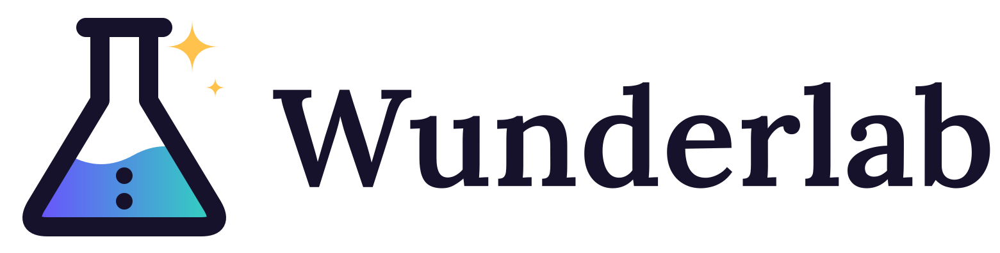

<p align="center">
  
</p>
 
<p align="center">
  <a href="https://www.repostatus.org/#wip">
    
  </a>
  <a href="LICENSE">
    
  </a>
</p>

# Wunderlab brand

Logos, icons, colors, and usage guidelines for [Wunderlab](https://wunderlab.eu), the local-first AI workspace.

## What's here

| Path | Contents |
|---|---|
| `svg/` | Master logos, mark, single-color marks, favicon, and app icons. Use these whenever you can. |
| `png/logo/` | Transparent PNG exports of every logo variant. |
| `png/icons/` | App icons, favicons, `.ico` files, PWA and Android icons. |
| `png/social/` | Avatar and 1200x630 link-preview card. |
| `tokens/` | Colors and fonts as CSS variables, JSON, and a Tailwind preset. |
| `brand-sheet.png` | One-page overview of the whole identity. |
| `BRAND.md` | Colors, type, clear space, minimum sizes, and which file goes where. |

## Using the tokens

```css
@import "@wunderlab/brand/tokens/tokens.css";
.hero { background: var(--wl-ink); color: var(--wl-paper); }
```

## Licensing

This repository has two licenses:

- **Logos, icons, and the Wunderlab name** (everything outside `tokens/`) are covered by the [Brand Assets License](LICENSE). In short: you can refer to Wunderlab and show the unmodified logo to point at the real project, but you can't use it to suggest your project is official, and modified builds need their own name and logo.
- **`tokens/`** (colors, fonts, Tailwind preset) is [MIT](tokens/LICENSE).

The Wunderlab software itself is licensed separately in each repository.

## Questions

Brand and permission requests: hello@wunderlab.eu
